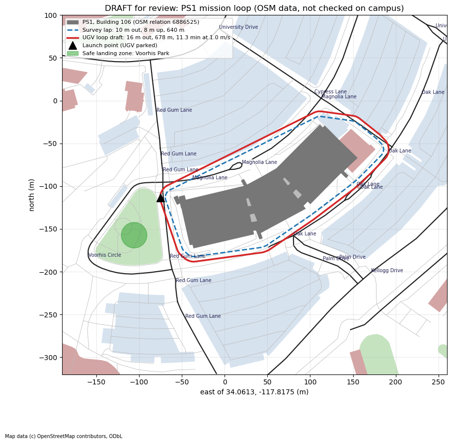

# Mission Loop: Inspect Parking Structure 1, Then Dock on the Moving UGV

*Docking team · written November 2, 2026 · Role: Autonomy · a plan, nothing built yet*

D3, the scored docking comparison, is the senior project and stays as it is. This is an experimental extension for the competitions: one **sortie** where the drone launches from the UGV, inspects Cal Poly Pomona's Parking Structure 1 (PS1), finds the UGV again and lands on it while it drives, in simulation. The detailed plan and the word list are `MISSION_PLAN.md` and `GLOSSARY.md` on the code repository's `experimental` branch.

**The UGV hardware comes first every week.** The mission simulation fills the gaps.

## The sortie

Five phases, in order, none skipped. A failed phase ends the sortie: the drone climbs to 30 m (above PS1's 22 m towers), flies to the safe landing zone in Voorhis Park and lands.

| Phase | What happens | Passes when (starting proposals) |
|---|---|---|
| Launch | Takes off from the UGV's deck while the UGV is stationary | 8 m within 15 s |
| Inspection leg | One lap of PS1, 10 m out, 8 m up, with a forward-facing camera; looks for 8 planted markers | 80% of markers found, each within 1.0 m |
| Rendezvous | Flies to where the UGV is now (its broadcast adds its GPS position) | Within 5 m of it within 60 s of the lap ending |
| Acquisition | The down-facing camera finds the deck's tags | Within 20 s |
| Docking | The D3 landing on the moving UGV, unchanged | The D3 rule |

The whole sortie has a 10-minute limit, standing in for the battery. The markers stand in for defects; real crack detection is future work.

**Two mission modes.** GPS mode (above) comes first. GPS-denied mode, after February 22, has the UGV park as a base; the drone inspects only the face of PS1 near it, returns by its own odometry, then UWB, then the tags, and lands on the parked UGV.

## Draft route, for the team to check on campus

Second draft, drawn from OpenStreetMap around Building 106 (the structure Google Maps calls "Magnolia Ln Parking") and Building 109 at its north-east end. Not checked on campus. The UGV loop (red, 678 m, about 11 minutes at 1.0 m/s) runs along Red Gum Lane, Oak Lane and Magnolia Lane. The launch point is on Red Gum Lane; the safe landing zone is Voorhis Park, across the road.

**PS1's size:** 12,103 m² footprint (about 782,000 sq ft over six decks) and 21.8 m to its highest point, from LA County data in OSM. The deck heights (about 3.4 m apart, roof deck about 17 m) are estimates until measured. **To check on campus:** whether the roads can be used with campus traffic, and whether Voorhis Park works as the safe landing zone.

## Competitions

- **Blue Skies 2027 ("InfraAir")** is the main one. A filmed campus sortie would support the proposal and video, due **Feb 22, 2027**. Its rules forbid generative AI in the submission.
- **NASA ORBIT 2027, Earth track**, at the professor's request, as a business plan: an inspection service with a docking UGV, built on F Prime (NASA software catalog NPO-49404-1) as the flight software. No prototype is required. Registration closes **Nov 16**; the Phase 1 paper (5 pages or less) is due **Dec 14**. ORBIT allows AI but requires disclosure; the team writes both entries. **To confirm with the professor before Nov 16:** that Cal Poly Pomona is on the FY 2026 eligibility list, and that the same students and idea may enter both competitions.

## Schedule

| When | What |
|---|---|
| Every week | UGV bring-up first ([HARDWARE_BRINGUP.md](./HARDWARE_BRINGUP.md)) |
| Nov 16 / Dec 14 | ORBIT registration / Phase 1 paper |
| Mid-December | Campus world in the simulator |
| Mid-January | GPS mode flying end to end |
| Early February | 20 scored sorties, filmed for the Blue Skies video |
| After Feb 22 | GPS-denied mode, then an F Prime sequencer for the five phases |

Map data © OpenStreetMap contributors (ODbL).
